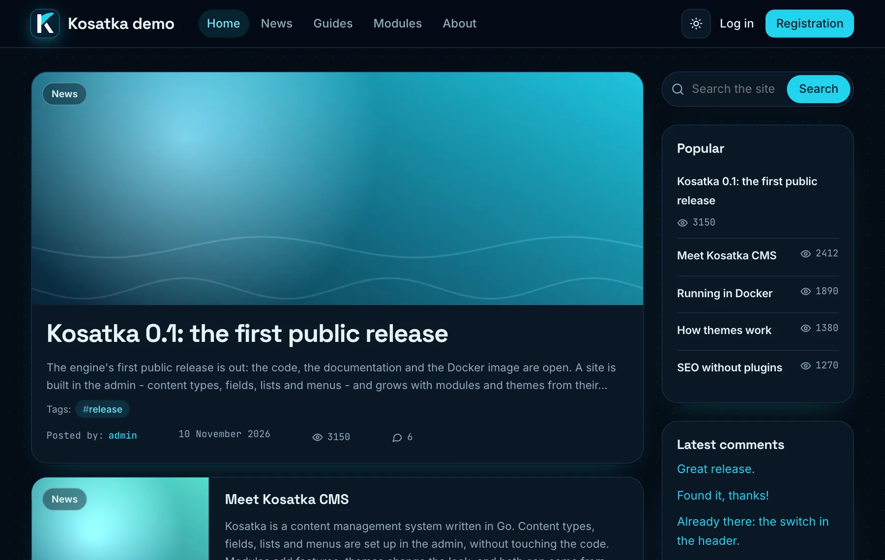
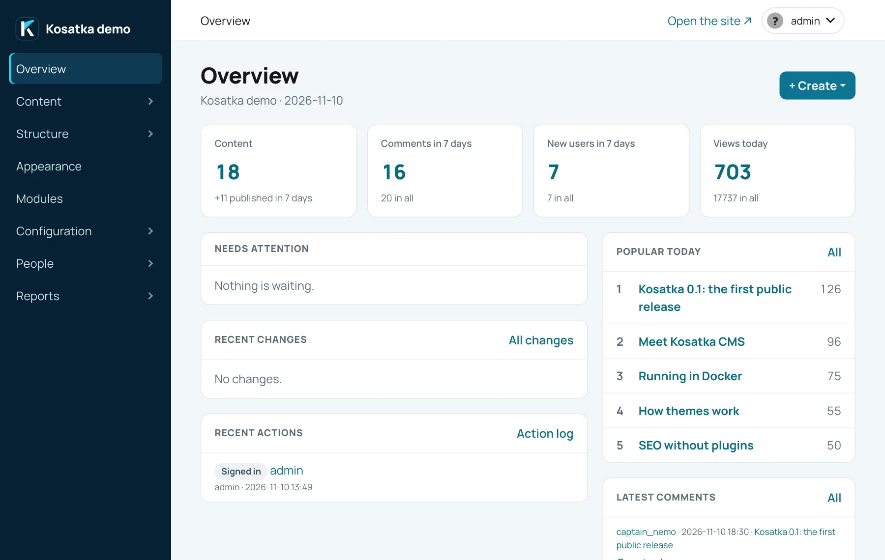

<p align="center">
  
</p>

<h1 align="center">Kosatka</h1>

<p align="center">
  <b>A content management system written in Go.</b><br>
  Powerful tools for building any kind of site - a blog, a news portal, a community, a company site -<br>
  in a convenient admin, without writing code.
</p>

<p align="center">
  <a href="https://kosatka-cms.github.io/kosatka/">Documentation</a> ·
  <a href="#quick-start">Quick start</a> ·
  <a href="https://github.com/kosatka-cms/kosatka/releases">Releases</a>
</p>

<p align="center">
  
  
</p>

## Features

- **[Content types and fields](https://kosatka-cms.github.io/kosatka/guides/content-types/)** -
  your own types with your own fields, including references between
  items, media and repeatable groups of fields.
- **[Views](https://kosatka-cms.github.io/kosatka/guides/views/)** - lists of content built
  in the admin: filters, sorts, pagers, related and similar content.
  Each one is a page, a block or a term page.
- **[Blocks](https://kosatka-cms.github.io/kosatka/guides/blocks/),
  [menus](https://kosatka-cms.github.io/kosatka/guides/menus/) and
  [taxonomy](https://kosatka-cms.github.io/kosatka/guides/taxonomy/)** - blocks in the
  theme's regions with visibility rules, menus, breadcrumbs, vocabularies
  with term pages.
- **[Users and roles](https://kosatka-cms.github.io/kosatka/guides/users-and-permissions/)** -
  permissions per role, registration or invitations, two-factor
  sign-in, social login.
- **[Publishing](https://kosatka-cms.github.io/kosatka/guides/content-types/#creating-and-editing-content)** -
  revisions, scheduled publishing, preview links for drafts, a trash.
- **[Embeds](https://kosatka-cms.github.io/kosatka/guides/embeds/)** - blocks, lists and
  forms right inside a text, inserted from the editor.
- **[Comments](https://kosatka-cms.github.io/kosatka/guides/comments/)** - moderation and
  spam checks.
- **[Search](https://kosatka-cms.github.io/kosatka/guides/search/) and
  [SEO](https://kosatka-cms.github.io/kosatka/guides/urls-and-seo/)** - search with live
  results, URL aliases and redirects, title and description templates,
  schema.org markup, a sitemap, RSS.
- **[Media](https://kosatka-cms.github.io/kosatka/guides/files-and-images/)** - image
  styles, a media library, files on disk or, with a storage package, in
  [S3-compatible storage or Azure Blob Storage](https://kosatka-cms.github.io/kosatka/guides/file-storage/).
- **[Mail](https://kosatka-cms.github.io/kosatka/guides/mail/)** - e-mail settings
  and texts in the admin; sending through any SMTP server, or a mail
  service's API with its module (Resend).
- **[Languages](https://kosatka-cms.github.io/kosatka/guides/languages/)** - a
  multilingual interface, the languages
  [downloaded separately](https://kosatka-cms.github.io/kosatka/guides/languages/#downloading-a-language);
  a site in several languages with the *Languages* module.
- **[Statistics](https://kosatka-cms.github.io/kosatka/guides/statistics/) and reports** -
  content views and other statistics, and a status report on the site's
  health.
- **[Security](https://kosatka-cms.github.io/kosatka/guides/security/)** - uploads
  checked by their content, private files, cleaned HTML, CSRF tokens,
  rate limits, an action log.

## Extending

- **[Modules](https://kosatka-cms.github.io/kosatka/modules/)** - add features with
  the built-in modules, switched on and off in the admin, and with modules
  from [their own repositories](https://kosatka-cms.github.io/kosatka/modules/using-modules/#add-a-module-from-its-own-repository),
  or [write your own](https://kosatka-cms.github.io/kosatka/modules/write-a-module/) in Go.
- **[Themes](https://kosatka-cms.github.io/kosatka/themes/)** - change the look with the
  bundled theme, one from the
  [themes catalog](https://github.com/kosatka-cms/themes) (all of them with
  their screenshots), or
  [create your own](https://kosatka-cms.github.io/kosatka/themes/create-a-theme/).

## Running

- **MySQL or PostgreSQL** - the schema migrations are built into the
  binary (`app migrate`).
- **Releases** - Linux archives (amd64, arm64) and a Docker image,
  `ghcr.io/kosatka-cms/kosatka`
  ([Running in production](https://kosatka-cms.github.io/kosatka/guides/production/)).
- **[Multisite](https://kosatka-cms.github.io/kosatka/guides/multisite/)** - one engine
  serves any number of sites, each with its own database, files and
  theme; one command updates them all, site by site, with a dump and a
  health check.

## Quick start

```bash
git clone https://github.com/kosatka-cms/kosatka.git && cd kosatka
docker compose up --build
```

Open <http://localhost:8080>: a site with demo content.
Sign in as `admin` with the password printed once in the log:

```bash
docker compose logs app | grep password
```

Other options, such as a site without the demo content:
[Run in Docker](https://kosatka-cms.github.io/kosatka/getting-started/docker/).
Without Docker:
[Run from source](https://kosatka-cms.github.io/kosatka/getting-started/from-source/).

## Documentation

<https://kosatka-cms.github.io/kosatka/>:
[getting started](https://kosatka-cms.github.io/kosatka/getting-started/),
[building a site](https://kosatka-cms.github.io/kosatka/guides/),
[themes](https://kosatka-cms.github.io/kosatka/themes/),
[modules](https://kosatka-cms.github.io/kosatka/modules/),
[the `app` commands](https://kosatka-cms.github.io/kosatka/reference/cli/),
[the configuration](https://kosatka-cms.github.io/kosatka/reference/configuration/)
and, for those who change the engine,
[how it works](https://kosatka-cms.github.io/kosatka/contributing/).

## Contributing

```bash
./scripts/check.sh       # golangci-lint (gofmt, go vet and more), unit tests
./scripts/check.sh -db   # plus the tests on MySQL and PostgreSQL and the migrations against the schema (Docker)
```

How changes are made: [CONTRIBUTING.md](CONTRIBUTING.md). To report a
vulnerability, see [SECURITY.md](SECURITY.md).

## License

[MIT](LICENSE)
