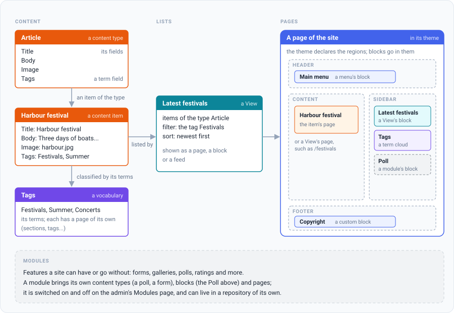

Kosatka is a content management system written in Go. It renders pages
on the server and keeps its data in MySQL or PostgreSQL. A site is built
in the admin from the parts below; modules and themes extend it.

## The parts of a site

- **Content.** Every page of content is a *node* of some *content type*
  (an article, a page, an event…). You create the types in the admin and
  give them fields ([the field types](../guides/content-types.md#field-types)).
- **Taxonomy.** Vocabularies of terms (sections, tags) that classify
  content. Each term has its own page.
- **Views.** Lists of content built in the admin: what to show, filters,
  sorting, paging. A View can be a page, a block, a list under content,
  the list on a term's page or a tab on user profiles; the front page and
  `/rss.xml` are Views too.
- **Blocks and regions.** A theme declares regions (header, sidebar,
  footer…); blocks are placed in them: menus, Views, text, a module's
  blocks.
- **Menus, addresses and SEO.** Menus, URL aliases and redirects,
  breadcrumbs, title and description templates and search are set up in
  the admin, per content type where it matters.
- **Users.** Roles and permissions, registration or invitations,
  profiles with fields, two-factor sign-in, social login.
- **Themes.** A theme is a directory with templates, styles and a
  manifest (`theme.yaml`): its regions, settings and subthemes. Themes can
  be installed from their own git repositories.
- **Modules.** Features a site can have or go without: forms, galleries,
  polls, ratings and [more](../modules/index.md). A module is turned on,
  off or uninstalled on the admin's Modules page. A module can also
  live in a repository of its own, and a site builds its binary with it.

## Where to start

- [Run Kosatka in Docker](./docker.md) - the quickest way to look around:
  one command, a site with demo content.
- [Run it from source](./from-source.md) - Go and a database of your own.
- [After installation](./first-steps.md) - signing in, the admin, the
  first settings.
- The reference: [the `app` commands](../reference/cli.md),
  [the configuration](../reference/configuration.md) and
  [the content model](../reference/content-model.md).
