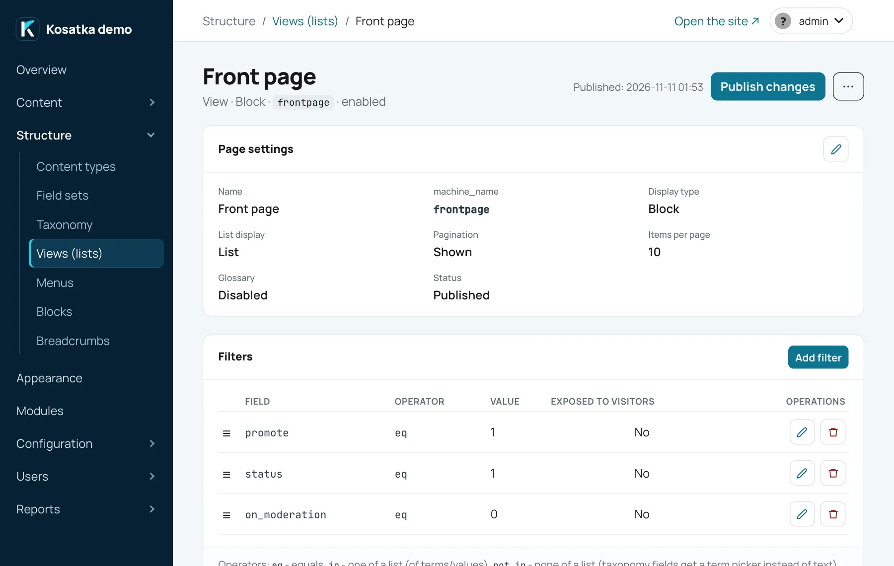

A View is a list you configure in the admin instead of writing a
template: which content it picks, in what order, which fields each row
shows and how the list looks. The same View can be its own page, a block
in a region, a list under articles, the list on a term's page or a tab
on user profiles. The front page feed and `/rss.xml` are a View too.

Views are managed in the admin under **Structure → Views (lists)**
(`/admin/config/views`).

## Create a View



1. Open `/admin/config/views`.
2. Under *Add view* enter a *Name*, choose the *Type* of the display
   (*Page*, *Block*, *Attachment to content* or *Term page*) and the
   *Base table*: *Content items* or *Comments*.
3. Press *Add*. The View page opens.
4. Add at least one field (*Fields* → *Add field*, for example `Title`),
   filters (*Add filter*) and sort criteria (*Add sort criterion*).
5. In *Page settings* → the pencil (*Change*), turn on *Status*
   (*Published (page is available)*) and save.

A new display starts unpublished, as a grid of 5 columns with 30 items
per page. A page's address is generated from the name; change it in
*Page settings*. The base table can't be changed after creation; the
display type can, including *Profile tab*, which is only offered there.

Each display has a *Machine name*, `view_<id>` when it is made. A
*Block* display's is what a text or a template embeds its list by
(`[[view:<machine name>]]`, [Embeds](./embeds.md)); the front page feed
picks a display by it too. Change it in *Page settings*: the front page
feed follows the new name; the tags with the old one show nothing.

A View without fields shows nothing: even the title is a field (a term
page and a theme template don't use the fields).

## Display types

| Type | Where it is shown | Its own settings |
|---|---|---|
| *Page* | at its own address, e.g. `/articles` | *URL*, *SEO title*, *SEO description* |
| *Block* | in a theme region, placed on the [Blocks](./blocks.md) page | - |
| *Attach to content* | on the pages of the chosen content types, after the text and before the comments | *Content types*, *Title on the page*, *Show title*, *Weight* |
| *Term page* | on the pages of terms of the chosen vocabularies, as the term's list of content | *Vocabularies*, *Weight* |
| *Profile tab* | a tab on user profiles: `/users/<user>/<tab path>` | *Tab path*, *Visible to*, *Weight* |

**Page.** The address is a path without the leading `/` and may have
several segments (`events/upcoming`). The form refuses an address
something else on the site answers: the engine, a content item, a term
page or a module's page (an enabled feed); a page added to a View or
copied gets a free one. Content answers an address first: an item that
gets the page's address later from its URL pattern takes it over (an
address typed in the content form is refused). Published pages go into
the sitemap and can be picked as menu links. One segment may be `%`:
`posts/%` answers `/posts/<alias>`, the user with that alias becomes the
value of a contextual `created_by` filter, and `%1` in the name or the
SEO title is replaced with their name. An unknown or blocked user gives
a 404. Such a page has an address per user, so it isn't in the sitemap.

**Block.** Has no address. Place it on the Blocks page with *Add View
block*. A block shows its first *Items per page* items; with *Show
pagination* (off for a new block) it has a compact pager (‹ the page
numbers ›) whose pages load in the block itself, without reloading the
page (without the script a pager link brings the visitor back to the
page). A block with a contextual filter has no pager.

**Attachment.** Several attachments on one page are ordered by *Weight*
(lower first). An attachment shows its first *Items per page* items,
without a pager; one with no results is not shown at all.

**Term page.** The list on a term's page comes from the published *Term
page* display whose vocabularies include the term's vocabulary (none
ticked means all); if several match, the lower *Weight* wins, and at
equal weights the one made first. Add the `has_current_term` contextual
filter so the list shows the term's content. A new site has one already,
*Term pages*: all vocabularies, weight 0, published content of the term,
newest first, 10 per page. To give one vocabulary a list of its own,
give its display a weight below 0. Without such a display term pages
have an empty list. The term page shows the items as the theme's teaser
cards: only the display's filters, sort criteria and *Items per page*
apply, not its fields or its look.

**Profile tab.** The tab path uses Latin letters (lowercased), digits and
hyphens, and can't be `edit`, `files`, the path of a module's profile tab
(`messages` of *Private messages*, `notifications` of *Subscriptions*)
or another profile tab's path. The tab's title is the display's name.
*Visible to*: *Everyone*, or *Profile owner and administrators* (others
get no tab and a 404 on its address). Add the `created_by` contextual
filter (`comment_created_by` for comments) so the tab lists that user's
content, or a user field's `is_profile_user` (contextual) so it lists
the content naming them: the projects someone is a member of, say.

### The front page feed and RSS

*Front page feed* on `/admin/config/system/site-information` picks the
content View whose list the front page shows, with its pager, and whose
first 20 items make `/rss.xml`; the View must be published. A new site
uses the *Front page* View: published content promoted to the front
page, sticky items first, then the newest. Choose *- None -* and the
front page has no feed and `/rss.xml` has no items. Separate XML feeds
come from the [Feeds](../modules/builtin/feeds.md) module.

## Choosing the content: filters

Filters narrow the list down; all of them must match. A filter targets a
built-in property or any field from the shared field catalog, so one
View can mix content types.

**A View has no implicit filters.** Without a `status` filter it lists
unpublished content too, and without `content_type` it lists every type.
Most lists need `status` = `1`: a content View without one says so above
its filters.

Built-in filters for content:

| Filter | Operators | Value |
|---|---|---|
| `content_type` | `eq`, `in` | one or several content types, picked from a list |
| `status` | `eq` | `1` published, `0` unpublished |
| `on_moderation` | `eq` | `1`/`0` - waiting for moderation |
| `promote` | `eq` | `1`/`0` - promoted to the front page |
| `sticky` | `eq` | `1`/`0` - sticky at the top of lists |
| `created_by` | `eq`, `in` | user IDs; or contextual (see below) |
| `title` | `eq`, `contains` | `contains` ignores case |
| `similar_to_current_node` | contextual only | content most similar to the current item, ranked (see [Similar content](#similar-content)); the value is a vocabulary, picked from a list, or *Any vocabulary* |
| `shares_terms_with_current` | contextual only | content sharing at least one term with the current item, unranked; the value is a vocabulary, picked from a list, or *Any vocabulary* |
| `has_current_term` | contextual only | content of the term whose page is shown |

Field filters, by field type:

| Field type | Operators |
|---|---|
| text, e-mail, phone | `eq`, `contains`, `empty`, `not_empty` |
| number | `eq`, `gte`, `lte`, `empty`, `not_empty` |
| date | `eq`, `gte`, `lte`, `ongoing`, `not_ended`, `ended`, `empty`, `not_empty` |
| boolean | `eq`, `empty`, `not_empty` |
| taxonomy | `eq`, `in`, `not_in` (terms are picked from a list), `empty`, `not_empty` |
| list | `eq` (one of its options' values), `in`, `not_in` (several, comma-separated), `empty`, `not_empty` |
| image | `empty`, `not_empty` |
| reference | contextual only: `referenced_by_current` - what the current item links to through this field; `related_to_current` - that, plus what links to the current item |
| user | `is_profile_user` (contextual only) - content naming the page's user in this field: the profile's user of a profile tab, the user of a `%` address, on a content page its author; `empty`, `not_empty` |

The form offers only the operators that fit the chosen field. `empty`
and `not_empty` take no value. `not_in` also keeps content that has no
value in the field.

For a date field, *Use relative date* takes an expression instead of a
date: `now`, `+7 days`, `-1 month`, `+2 weeks`, `+1 year`. It is
calculated from today's date in the site's time zone (`now` is today),
each time the list is built. A date field's filter compares the start of
a value; a date (not a relative one) covers its whole day, so `eq` and
`lte` take a start with a time on that day - the day in the site's time
zone.

`ongoing`, `not_ended` and `ended` take no value: a date going on now, a
date going on or still to come (a poster of events), a date that has
ended (an archive). A date without a time ends with its day in the
site's time zone, one with a time at its end (or its start without an
end). For a field with several dates, a content item is going on or not
ended when one of its dates is, ended when all are. A View block keeps
its list until its next refresh ([Caching](#caching)), so an event can
stay in a "not ended" block for up to 15 minutes after it ends.

**Fields of blocks.** The picker's *Fields of blocks* lists the fields
of the field sets of every blocks field, as *Cast › Actor*. Such a filter
keeps the content with a block that matches: *Cast › Actor* with
`related_to_current` (contextual), in a block on an actor's page, lists
the films the actor plays in; *Cast › Character* `contains` "doctor" -
the films with such a role. `empty` and `not_in` keep the content with
no block that has it. A field only field sets have isn't in the shared
catalog: no content item has it itself. See
[Field sets](./content-types.md#field-sets).

### Where the value comes from

| Source | How | Without it |
|---|---|---|
| Fixed | the *Value* you enter | an empty value turns the filter off |
| *Exposed to visitors* | a query parameter, named in *Query parameter* (`?publisher=…`): lowercase latin letters, digits and `_`, starting with a letter, one per exposed filter of the display, not `page`, `letter` or `sort` (the page's own) | no parameter - no restriction |
| *Contextual* | the page being shown: the current content item, the profile's user, the user from a `%` address, the term | no context - the list is empty |

A filter can't be both exposed and contextual. A list built for a
content item - an attachment, or a block with a contextual filter -
leaves that item itself out.

### Exposed filters

A View page shows a form for its exposed filters above the list. The
label is *Label on the public form*, or the field's name. The form gets
a text box for text fields and the title, number and date inputs, a
Yes/No choice for booleans. A filter on options - a taxonomy field's
terms, a list field's options, a module's choices - is a drop-down for
`eq` (one option) and checkboxes for `in` and `not_in` (several: the
visitor ticks what to show, or what to leave out). Ticked boxes send
the parameter once per option (`?verdict=great&verdict=masterpiece`);
a comma-separated value (`?section=3,5`) works as well. Other exposed
filters have no form control but still work from the address. The
pager keeps the parameters. A page filtered this way is marked
`noindex`.

Exposed filters work on a View's own page only: blocks, attachments,
term pages, profile tabs and the front page feed show no form and read
no parameters, so their exposed filters restrict nothing.

### Contextual filters in blocks

A View block with a contextual filter is built for each content page
from the item being viewed, so "more from this author" or "related
articles" follows the page. Such a block works only with the visibility
*Everywhere* or *Only on specific content types* (see
[Visibility](./blocks.md#visibility)) and shows nothing on pages without
a content item.

### Similar content

`similar_to_current_node` lists the published content that shares the
most taxonomy terms with the item being viewed, any content type (add a
`content_type` filter to keep one). Its *Vocabulary* setting chooses whose
terms are compared, for example the tags; *Any vocabulary* compares all of
them.

A shared term counts more the rarer it is: it weighs `1 / ln(1 + n)`, `n`
being how many published items carry it (the current one included). A term
of 2 items weighs 0.91, of 10 items 0.42, of 300 items 0.18, so one rare
shared tag ranks an item above another sharing two common ones. The list is
ordered by the sum of the shared terms' weights; equal sums go by more
shared terms, then by the View's own sort criteria, then by the lowest
content ID. The page size and the pager apply to that ranked list.

The ranking is computed when the list is shown, from the terms as they are
at that moment: new content and changed terms count at once. Unpublished
content and content waiting for moderation is never listed and doesn't
count towards `n`.

## Sorting

Sort criteria apply in order: the first is the main key, the next ones
only break ties. Drag the rows to reorder them. With no criteria the
list is newest first. A criterion's field can't be changed afterwards
(delete it and add another), its *Direction* can.

| Built-in criterion | |
|---|---|
| *Creation date*, *Update date*, *Name* | the item's dates and title |
| *Page views* | total views |
| *Page views today* | today's views; items not viewed today are left out |
| *Page views, 7 days*, *Page views, 30 days* | the views of the last 7 or 30 days, today included; items not viewed in them are left out (see [Views and popular content](./statistics.md)) |
| *Random* | a random order each time the list is built; a block keeps its order until its next refresh ([Caching](#caching)) |
| *Sticky (descending: sticky first)* | sticky items first; add a second criterion to order each group. The bundled themes show a sticky item larger, leading the list |

Text, number and date fields can be sort criteria too. A field with
several dates sorts by the nearest of them not ended yet (all ended -
the latest): with `not_ended` and ascending order, a list of what's
coming next. `similar_to_current_node` orders the list by its own
ranking; the sort criteria only order the items that rank equally.

### Sorting chosen by visitors

Tick *Offer to visitors* on a criterion, give it an *Option label*
("Cheapest first") and a *Value in the address* (`price-asc`: Latin
letters, digits, `_` and `-`, unique in the display). The criteria
offered this way are alternatives: the page shows a *Sort by* drop-down
of their labels next to the exposed filters, and only the chosen one
applies - in the place of the first offered criterion; the criteria not
offered keep their places. With no choice the first offered one
applies, as in a block of the View.

For "cheapest first" and "most expensive first", add the price field
twice, ascending and descending, each with its own label. Put *Sticky*
before the offered criteria to keep sticky items on top whatever the
visitor picks, and a criterion after them to break ties.

The choice is the `sort` parameter (`/products?sort=price-asc` works as
a link); the pager keeps it, and a page with it is marked `noindex`.

### Criteria of modules

An enabled module can add its own sort criteria, filters and fields - a
rating, a number of votes. The pickers list them under *Modules*. A
module's criterion or field may have settings of its own in each View,
shown under the picker (a rating's threshold, how it is shown). A
module's filter compares a number (`eq`, `gte`, `lte`, `empty` - the
item has no value, `not_empty`) or picks among its options, a workflow
state, say (`eq`, `in`, `empty`, `not_empty`); either can be exposed.
While the module is disabled its criteria are not applied (the View's
cards show their keys instead of their names), and uninstalling the
module removes them from every View.

## What each row shows: fields

The *Fields* card lists what a row shows, in order (drag to reorder).
Built-in fields: `Title`, `Content type`, `Status` (*Published*,
*Unpublished* or *On moderation*), `Creation date`, `Update date` (its
last save), `Page views`, `Comments` (their number), `Reading time`
("5 min read": the item's long text fields shown on its page at 200
words a minute; nothing for an item without text), `Author` (a link to
the profile), `Link to content` (a "Read more" link; its text is the
field's *Label*) and `Link to edit the content` (an "Edit" link to its
form; shown to everyone who sees the list, the form opens only for who
may edit the item - for a list of one's own content or an editors'
list). Any field of the catalog can be added, except groups, files and
blocks fields.

A list of a user's own content with drafts - a *Profile tab* visible to
the *Profile owner and administrators*, the contextual `created_by`
filter and no `status` filter - shows each item's state with `Status`,
`Update date` and `Link to edit the content`.

`Title` shows an item's alternative title when its type has one
([Content types](./content-types.md#type-settings)) - everywhere but on
the View's own page and in its preview, which show the title. A date
field with times or periods shows them as on the content page.

| Field setting | What it does |
|---|---|
| *Label*, *Show label* | the label in this View (empty - the field's name) and whether it is shown |
| *Image style* | the image style for an image field; an image without a style is not shown |
| *Images* | an image field with several images: *The first* (the default) or *All*, a row of them |
| *Several dates* | a date field with several dates: all (the past ones marked), only those not ended, the nearest and "N more", or the first |
| *How to show*, *Several values* | a link field: as links or in a module's way (a video preview, say), and how several values show - one after another, the first large and the others small, or only the first; independent of the content page's choice |
| *Date format* | a format from `/admin/config/date-formats`; empty - the field's own |
| *Tag format* | taxonomy fields: `plain` (names), `linked` (links), `badges`; a term of a vocabulary without public term pages is never a link |
| *Link* | *To the content*, or *To the original image* for an image; not for taxonomy and link fields, which are links themselves |
| *Custom CSS class* | a class on the field's wrapper |
| *Trim text (characters)* | strips the HTML, leaves out the code blocks (`<pre>`) and cuts the text at a word boundary, with "…" |
| *Rewrite HTML* | your markup around the value: `{{value}}` is the value, `{{field:<key>}}` another field of the row |
| *Exclude from display* | the field isn't shown itself but is available as a token |
| *Hide in the compact "rest" list* | see *Show the first N in full* below |
| *Fallback field* | the key of another field shown when this one is empty |

A field's key in tokens is its machine name, or the built-in's name
(`title`, `created_at`…).

## How the list looks

*Page settings* → the pencil (*Change*) holds the list's look, under
*Display*. For a display in a group (see below) these settings may be
inherited.

| Setting | What it does |
|---|---|
| *List display* | *List* (a row per item), *Grid (cards)* (*Grid columns* across), *Table* (a column per field), *Carousel* |
| *Show the first N in full, the rest as a list* | the first N items in the chosen style, the rest as a compact list under *Heading above the compact list*; 0 - off |
| *Show pagination*, *Items per page* | a pager (`?page=2`) and the page size; a block's pager loads its pages in place |
| *Skip the first N items* | the first N items of the result are left out: every page starts after them, the pager counts the rest; 0 - none |
| *AJAX pagination (no page reload)* | the pager and the index letters load the list in place (content View pages; a block always does) |
| *Text before the list*, *Text after the list* | rich text around the list, shown even when the list is empty |
| *Custom CSS* | CSS put in with the list; limit your selectors to the list's container yourself - `#view-list-container` on the View's own page, `#view-list-container-block-<display ID>` elsewhere (a block, an attachment, a profile tab) |
| *Row template* | your markup for a row (see below) |
| *Group by field* | a heading for each value of a field; dates by year, month or day |
| *Alphabetical index (A B C…)* | a letter bar filtering by the first letter of the *Index field* (the title by default); add a matching sort |
| *Theme template* | a template of the active theme renders the list instead (see below) |

Carousel settings: *Slides per view*, *Autoplay*, *Loop*, *Navigation
arrows*, *Pagination dots*, *Transition effect* (*Slide* or *Crossfade*)
and *Slide link field*: a text field whose value the slide links to.
Without it, or when an item's value is empty, the slide links to the
content item.

Grouping works within one page, in grid, list and table, not in a
carousel.

A grid card shows the picture on top in its image style's shape (a wide
card, a tall cover) and the fields under it; its title is the built-in
*Title* when the View shows it, else the first field with a value. On a
tablet the grid has two columns, on a phone one.

### Row template

A row template replaces the default card markup in a list, grid or
carousel (not a table). Tokens: `{{field:<key>}}` is a field's rendered
value (with its image style, terms and link), `{{url}}` is the content
item's address. For example, with links turned off on the fields:

```html
<a href="{{url}}" class="card">{{field:cover}}<h3>{{field:title}}</h3></a>
```

Don't wrap a field that has its own *Link* in `<a href="{{url}}">`:
nested links break the card. `{{field:…}}` puts in HTML, so it doesn't
work inside an attribute. Style the cards in *Custom CSS*.

### Theme template

*Theme template* is the name of a file in the active theme:
`views/<name>.html` with a `view_<name>` block renders the list in place
of the display style. Without that file the display style is used. It
applies to pages, blocks, attachments, profile tabs, the front page feed
and embedded lists, right away, without publishing. Writing such a
template is covered in [Templates](../themes/templates.md).

## Displays of one View

A View can have several displays sharing their settings, like a page of
all articles and a block of the latest five.

- *Duplicate* (the copy icon on the list, or the View page's ⋯ menu)
  copies a display: the copy has the name with " (copy)" added and is
  unpublished. The first duplicate turns the View into a group with a
  *Default* display holding the shared settings, seeded from the
  original: its name is the original's with " - Default" added, its tab
  reads *Default*, and the list shows the group under the View's name.
  *Default* itself is never shown on the site. The original and its
  first copy keep their own settings (every card overridden) until you
  revert their cards.
- *+ Add display* adds a display to the group that inherits everything.
- Each of the four cards (*Page settings*, *Filters*, *Fields*,
  *Sorting*) is either inherited from *Default* (read-only, with an
  *Override* button) or overridden (with *Revert to default*). Name,
  machine name, type, address, SEO title and description, theme
  template, status and the placement settings are always the display's
  own.
- *Delete* in a display's ⋯ menu deletes that display; deleting a
  group's row on the list deletes the whole View with all its displays.

## Publishing changes

Edits are saved at once, but visitors keep seeing a display's last
published version wherever it shows - its page, a block, an attachment,
a term page, a profile tab, the front page feed, an embedded list, the
front page's RSS - everyone, administrators included:

- *Publish changes* makes the current configuration the public one;
  *Discard changes* goes back to the published one. The bar at the top
  of the View page says when there are unpublished changes; in a group,
  a `*` on a display's tab marks them.
- A new site's Views come published. A display added in the admin shows
  its current version until it is published for the first time.
- The address, machine name, status, type and theme template apply at
  once.
- A field deleted since the publishing drops out of the published
  version's filters and sorting.

*Preview* at the bottom of the View page shows the list with the
current, unsaved settings, in the site's theme; with *Refresh
automatically* on, it is redrawn after every change.

An unpublished display (*Status* off) isn't shown. Its page answers 404,
except to users who may view unpublished content: they see it with a
notice.

## Caching

View blocks are built ahead of time and kept in memory. Saving anything
in a View rebuilds them at once. Content created, edited, published or
deleted - and comments - reach them within a few seconds (a burst of
changes rebuilds them once); the rest is refreshed every 15 minutes. To
refresh them right away, use *Clear cache* on the Performance page
(`/admin/config/performance`). Pages, attachments and blocks with a
contextual filter are built on each request, and so are a block's pages
after the first.

A block is built as a guest sees it. While some content type is closed
to guests ([Content types](./content-types.md#type-settings)), a block
that would show its content is also built for the visitors who may
view it - once for each set of closed types, on the first visit after a
refresh.

## Comment Views

With the *Comments* base table a View lists comments - those on
published content only.

- Filters: `comment_node_type` (the type of the commented content),
  `comment_status` (`1` published, `0` waiting for approval, `2` spam;
  without it the View lists the published comments only),
  `comment_created_by` (may be contextual),
  `comment_subject`, `comment_content` (`eq`/`contains`),
  `comment_is_reply` (`0`/`1`).
- Fields: *Subject*, *Text*, *Author*, *Date*, *Content item*.
- Sorting: by date or by subject, one criterion.
- Styles: list, grid, table. Displays: page, block, profile tab.
- No publishing, alphabetical index, AJAX pager (but in a block) or
  exposed filters form (exposed filters still work from the address).

## Examples

**Latest articles in the sidebar.** A *Block* display. Filters:
`content_type` `eq` *Article*, `status` `eq` `1`. Sort: *Creation date*,
descending. Fields: `Title` with *Link* *To the content*,
`Creation date`. *List display* *List*, *Items per page* 5. Turn on
*Status*, then place it in the *Sidebar* region with *Add View block*.

**A section page.** A *Page* display at `news`. Filters: `content_type`
`eq` *Article*, `status` `eq` `1`, the taxonomy field `section` `eq` the
*News* term. Sort: *Sticky*, then *Creation date* descending. Fields: an
image with a style, `Title`, the body with *Trim text* 200. *Grid
(cards)*, 3 columns, pagination on. Add it to the main menu as a *View*
link.

**A lead story and the rest.** Two displays with the same filters and
sort (a group shares them): a block with *Items per page* 1 for the lead
story, shown large, and a page or a block with *Skip the first N items*
1 for the rest, in a grid with a pager. The lead story is not repeated
in the list, on any of its pages.

**A catalog with a search box.** A *Page* display at `products` of
*Product* content with `title` `contains`, *Exposed to visitors*,
*Query parameter* `q`. Visitors type in the box; `/products?q=lamp`
works as a link.

**Upcoming events.** Filters: `content_type` `eq` *Event*, `status` `eq`
`1`, the date field `starts` `not_ended` (or `gte` `now` with *Use
relative date*: only what starts from today on). Sort: `starts`
ascending. Group by `starts`, *Date: by month*.

**Related content under an article.** An *Attach to content* display for
*Article*, *Title on the page* "Related". Filters: `status` `eq` `1`,
`similar_to_current_node` (contextual) with the tags vocabulary: the most
similar first. 4 items, no pager. Or use `shares_terms_with_current` for
any item with a common term, or a reference field with
`referenced_by_current`.

**More from this author.** A *Block* display with `created_by`
contextual and `status` `eq` `1`, placed with visibility *Only on
specific content types*.

**A user's articles on their profile.** A *Profile tab* display, *Tab
path* `articles`, filters `content_type` `eq` *Article*, `status` `eq`
`1`, `created_by` contextual. It opens at `/users/<alias>/articles`.
