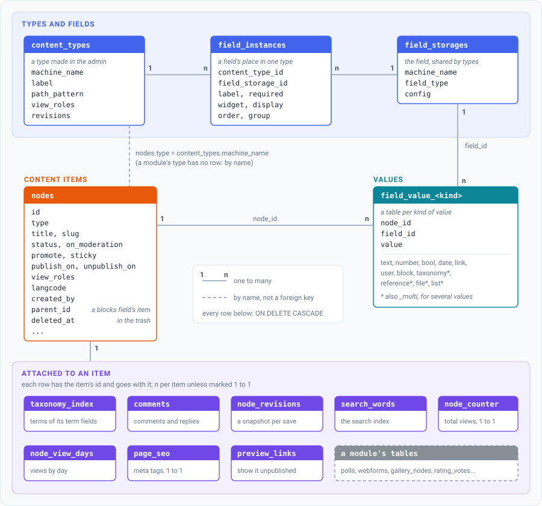

Every piece of content - an article, a page, a poll, a form - is a
**content item**: a row of `nodes` (`entity.Node` in the code). Its
type decides which fields it has; the values of those fields live in
tables of their own, one per kind of value. This page shows the tables
and what the engine does with an item from its first save to its
deletion. For how a site builder sees the same things, see
[Content types and fields](../guides/content-types.md).

These are the engine's tables as they are now, not an interface: their
columns change with the engine's migrations. A module reads and changes
content through the SDK's services (see [In a module](#in-a-module));
SQL reports and imports should expect the schema to move with the
engine's releases.

## The tables

Every table that hangs off `nodes` references it with `ON DELETE
CASCADE`: deleting the row deletes the rest. The one exception is a
reference field's target (`field_value_reference.target_node_id`): an
item pointing at another one isn't deleted with it, its value is.

### Types

A **content type** created in the admin is a row of `content_types`:
its address pattern, comment and publishing defaults, who may view it
(`view_roles` - a closed section), whether it keeps revisions. A
**module's type** (a poll, a form) has no row there: the module
declares it in its manifest (`NodeTypes`) and keeps its data in its own
tables. Either way `nodes.type` holds the type's machine name.

### Fields and values

A field has two parts. Its **storage** (`field_storages`) is the field
itself: a machine name unique on the site, its kind (`field_type`) and
the settings every type that uses it shares (`config`: a text's
maximum length, the vocabulary of a term field, a list's values...).
Its **instance** (`field_instances`) is its place in one type: the
label, whether it is required, the widget, how it is shown, its order
and group in the form. Attaching an existing field to another type adds
an instance, not a second field - the values of both types are in the
same table, under the same `field_id`.

Values are in typed tables, `field_value_<kind>`: `node_id`, `field_id`
and the value in a column of its type - text with its text format, a
number, a date, a term's, a file's or another item's id. A field with
several values uses the `_multi` table of its kind. Each table is read
and written by one store (`ent/database/field_store_*.go`), registered
for the field types it keeps (`registerFieldStorage`): adding a kind of
value is a store, not a change of the repository.

A **blocks field** holds items of its own: each block (a text, a
quote, a gallery of a field set) is a node too, with `parent_id` set to
the item holding it and a row in `field_value_block` (`item_id`, its
`delta` - the order). They aren't content of their own: every node
query leaves them out (see below).

## Saving an item

The content form (`DynamicContentController`, `/create/{type}`,
`/node/{id}/edit`) saves everything in **one transaction**: a failure
anywhere leaves the item as it was (or no item, on create).

1. What reading the form only noted is written first: new terms typed
   into a term field, alt texts of images.
2. The `nodes` row and the field values (`DynamicContentRepository`):
   each store replaces the item's values of its fields; a blocks
   field's items are saved as nodes of their own first.
3. The search index (`search_words`): the words of the title and of the
   text fields, in the item's language (`langcode`, the site's when the
   item has none).
4. The meta tags (`page_seo`), when the user may set them.
5. `taxonomy_index`: rebuilt from all the item's term fields - term
   pages, related lists and Views filters read it, not the fields.
6. The modules' parts: the settings sections they add to the form
   (`modulekit.AddNodeSettings`), an editorial workflow's transition
   (`SetNodeWorkflow` - it then decides the item's publishing), and the
   calls of `modulekit.OnNodeFormSaved`.
7. The history (`NodeRevisionService`): for a type that keeps
   revisions, a snapshot of the item and its values; an item that
   becomes public is announced to `OnNodePublished`; what changed of
   its status, author or address goes to the action log.
8. A changed address: the old one redirects to the new one
   (`redirects`).

After the transaction, a change of who may view the item makes the
engine read who views what again and render the cached blocks anew.

A module that changes an item outside the form wraps the change in
`modulekit.ChangeNode`: it gets the same transaction, revision and
announcement.

## Publishing

- `status` - published or not; `on_moderation` - waiting for approval
  (`/admin/moderation`); `promote` and `sticky` - on the front page and
  pinned at the top of lists.
- `publish_on`, `unpublish_on` - the schedule: a background job
  (`ScheduledPublishing`) publishes and unpublishes items when their
  time comes.
- A type an editorial workflow handles is published by the workflow's
  transitions only (`service.PublishingManaged`): its form has no
  publish checkbox, the bulk actions and the publish route leave its
  items out, a schedule set before it joined is cleared.
- `preview_links` - a link that shows an unpublished item to whoever
  has it, for a week.

## Addresses

An item's address is its `slug`, unique on the site. With `path_auto`
the slug comes from its type's `path_pattern` (tokens such as the title
or a term, `NodePathService`); otherwise the editor types it. A
module's type may put its items under a prefix of its own (the
manifest's `PathPrefix`). `/node/<id>` redirects to the address, and an
address that changed keeps redirecting.

## Reading and access

The `Node` schema's interceptor adds its conditions to every node query,
so no list, count, feed or search forgets them. It leaves out a blocks
field's items, the items in the trash and what the request's visitor
may not view - a closed type (`content_types.view_roles`) or an item
restricted to other roles (`nodes.view_roles`). The details and the
ways around it for the engine's own lookups are in
[Rows every query leaves out](../contributing/database.md#rows-every-query-leaves-out).

## Deleting an item

Every deletion goes through `NodeDeleteService` - the form, the bulk
actions, a module's uninstall:

- An item of an admin type goes to the **trash** first: `deleted_at`
  and `deleted_by` are set, and the interceptor hides it. A background
  job deletes it for good after `trash_days` (30 by default), or an
  editor restores it or empties the trash. A module's type has no
  trash: its items are deleted for good at once.
- **Deleting for good** collects the item's files (file fields and the
  modules' `NodeFiles`), then, in one transaction, clears the
  references to it and deletes its `nodes` row - everything else goes
  with it by cascade. The files nothing else uses are deleted after,
  and the action log records the deletion.

## In a module

- A table of the module's that belongs to an item has the item's id
  and a foreign key to `nodes` with `ON DELETE CASCADE` (in its ent
  schema, a stand-in for the core's table - `schemakit.Table("nodes")`):
  deleting the item deletes its rows, with nothing to register.
- Files in the module's tables that belong to an item are declared in
  the manifest (`NodeFiles`), so deleting the item deletes them too.
- The core's tables aren't part of the SDK: read and change items
  through its services (`Nodes`, `NodeRepo`, `ChangeNode`), so the
  search index, the history and the caches follow. See
  [The module SDK](../modules/sdk.md).
